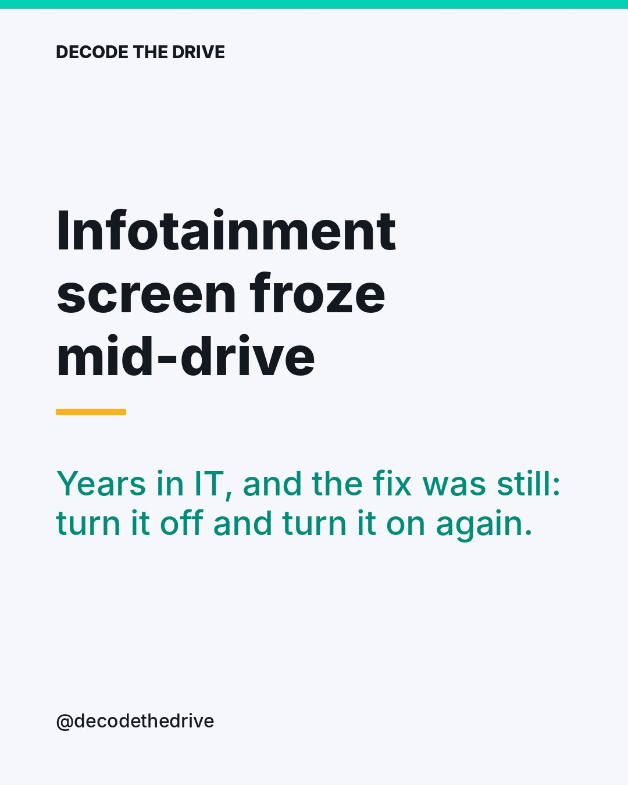
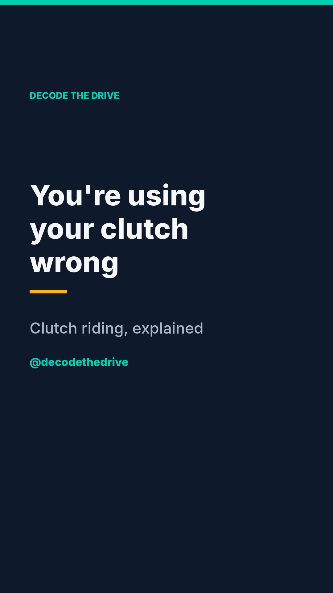
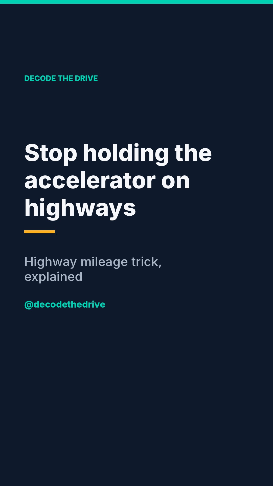

# Week of 2026-10-18: Drive smarter: clutch habits, highway coasting, the hybrid label decoded, and the Sedan vs SUV debate

Check the posts below. If they look good, run **approve-all** from the Actions tab.

## 2026-10-26 20:00 · meme · IT fix for frozen infotainment
Post id: `785b4bce`

**Caption:**

Every IT person's first instinct, now applied to a car 😅

Genuinely though, a full restart (car off, door open and close, wait a bit, start again) clears many infotainment glitches. If it keeps freezing, ask your service centre whether a software update is available for your unit.

Tag the colleague who says 'have you tried restarting?' for everything 👇

#CarMemes #ITLife #TechHumour #Infotainment #CarTech #AndroidAuto #AppleCarPlay #DesiDrivers #IndianCars #EngineerLife #CarLife #DecodeTheDrive

## 2026-10-27 19:30 · reel · Clutch riding fix
Post id: `5dfc9efa`

 (tap for the video)

Music: vaitsez-dark-beat-620108.mp3 (phonk)

YouTube Shorts title: **Clutch riding: the habit that wears out your clutch plate**
YouTube hashtags: #shorts #DrivingTips #Cars

**Caption:**

This one is from my own driving habits 🚗

Many people keep the clutch pressed while turning, or drive with their foot resting lightly on it. Both wear out the clutch plate faster, and an expensive clutch job comes sooner than it should.

My rule: press the clutch only to change gear (and of course when moving off or coming to a stop so you don't stall). The rest of the time, your left foot lives on the dead pedal.

Bonus safety point: taking a turn with the clutch pressed means the car is coasting with less control. Turn in the right gear, foot off the clutch.

Save this and send it to the friend who rides the clutch 👇

#ClutchRiding #DrivingTips #ManualCar #CarCare #CarMaintenance #IndianRoads #DriveSmart #CarTips #CarTech #IndianCars #NewDriver #DecodeTheDrive

## 2026-10-28 19:30 · reel · Strong vs mild hybrid
Post id: `53e3fcd2`

 (tap for the video)

Music: paulyudin-tech-corporate-182507.mp3 (tech)

YouTube Shorts title: **Strong hybrid vs mild hybrid: what is the real difference?**
YouTube hashtags: #shorts #HybridCars #CarTech

**Caption:**

'Hybrid' on the boot lid can mean two very different things 🔋⛽

Strong hybrid: a bigger battery and electric motor that can move the car on electric power alone at low speeds, like the Honda City e:HEV. That's why they shine in stop-go city traffic.

Mild hybrid: a small motor-generator that assists the engine and runs start-stop. Helpful, but it cannot drive the car on electric power alone, so the mileage gain is smaller.

Mostly city driving? A strong hybrid makes the most sense. Mostly highway? The gap between them narrows.

Which one would you pick? Tell me in the comments 👇

#StrongHybrid #MildHybrid #HybridCars #HondaCity #eHEV #CarTech #FuelEfficiency #CarBuyingTips #IndianCars #Mileage #CarExplained #DecodeTheDrive

## 2026-10-30 19:30 · reel · Highway pulse and coast mileage tip
Post id: `83b60661`

 (tap for the video)

Music: alex-morgan-lofi-beat-587404.mp3 (chill)

YouTube Shorts title: **How to get better highway mileage: the coast and press trick**
YouTube hashtags: #shorts #MileageTips #Cars

**Caption:**

From driving my VW and Skoda on long highway runs, this one habit made a clear difference to my mileage ⛽

Don't keep the accelerator pressed continuously. Press gently up to about 100 km/h, lift off and let the car coast down to about 90, then press lightly again. Repeat. Avoid heavy or full throttle.

It works on EVs too: smooth, light inputs help your range.

Important safety notes:
• Stay in gear while coasting. Never shift to neutral to coast.
• Only do this on a clear road with a safe gap to the car ahead, not in dense traffic.
• Always stay within the posted speed limit for that road.

Try it on your next road trip and tell me what mileage you got 👇

#MileageTips #FuelEfficiency #HighwayDriving #RoadTrip #Volkswagen #Skoda #EVRange #DrivingTips #CarTips #IndianRoads #CarTech #DecodeTheDrive

## 2026-10-24 11:00 · carousel · Sedan vs SUV vote
Post id: `46a1bead`

**Caption:**

The debate that never ends in Indian car groups 🔥

Sedans: lower, planted at highway speeds, separate boot. Think Honda City, Skoda Slavia, VW Virtus.
SUVs: higher seating, more ground clearance for broken roads and speed breakers. Think Hyundai Creta, Mahindra XUV 3XO.

Cast your vote in the comments: S for Sedan, U for SUV. And tap the poll in my story to see live results 🗳️

Best argument in the comments gets pinned 👇

#SedanVsSUV #Sedan #SUV #CarDebate #HondaCity #SkodaSlavia #VWVirtus #HyundaiCreta #Mahindra #IndianCars #CarBuyingTips #CarLovers #DecodeTheDrive

## Story polls (post these yourself)

- **Mon**: Has your car's infotainment ever frozen on you?  (Yes, too often / Never, it's solid)
- **Tue**: Be honest: do you rest your foot on the clutch?  (Guilty / Never, dead pedal)
- **Wed**: Your next car: strong hybrid or mild hybrid?  (Strong hybrid / Mild hybrid)
- **Thu**: What matters more on Indian roads?  (Ground clearance / Highway stability)
- **Fri**: Do you check your mileage after every road trip?  (Always / What's mileage?)
- **Sat**: Sedan or SUV: which do you prefer?  (Sedan / SUV)
- **Sun**: What should I explain next?  (EV battery life / DCT in city traffic)
