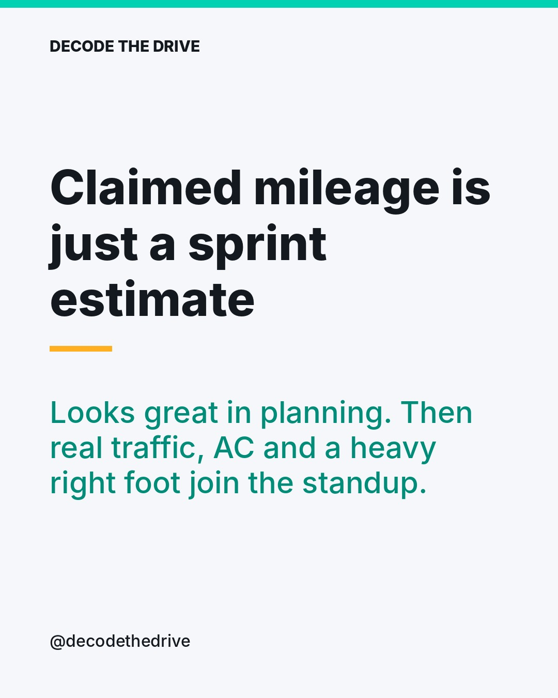
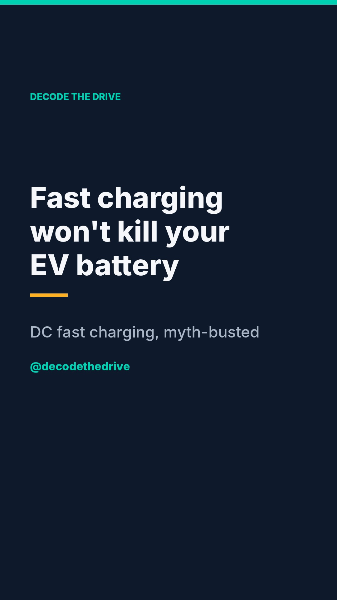
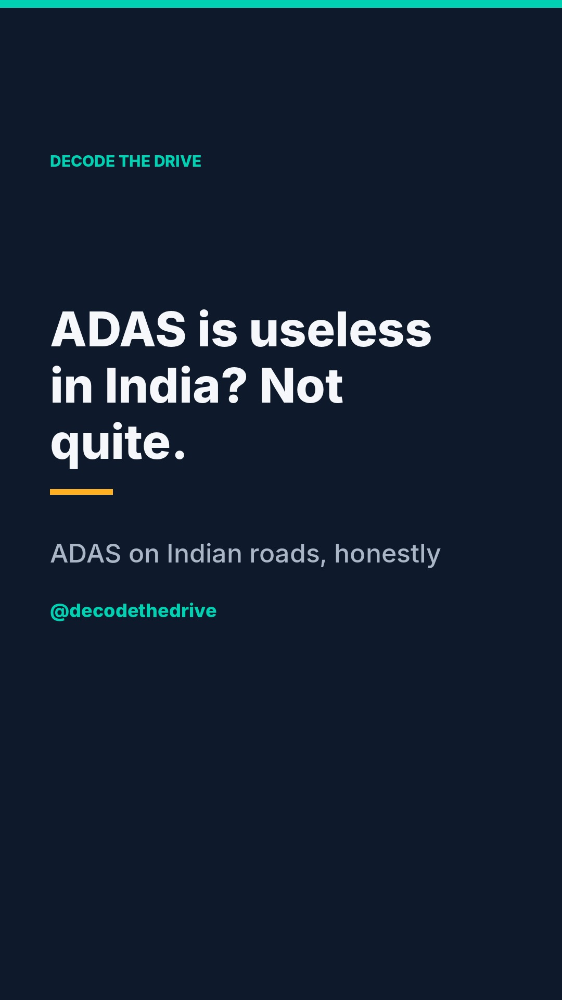
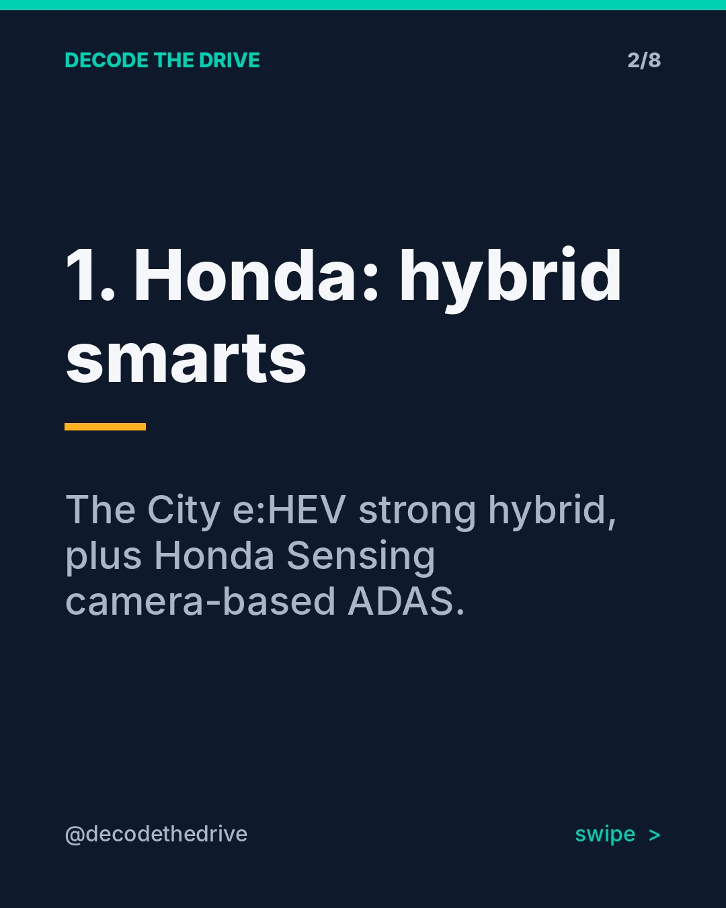
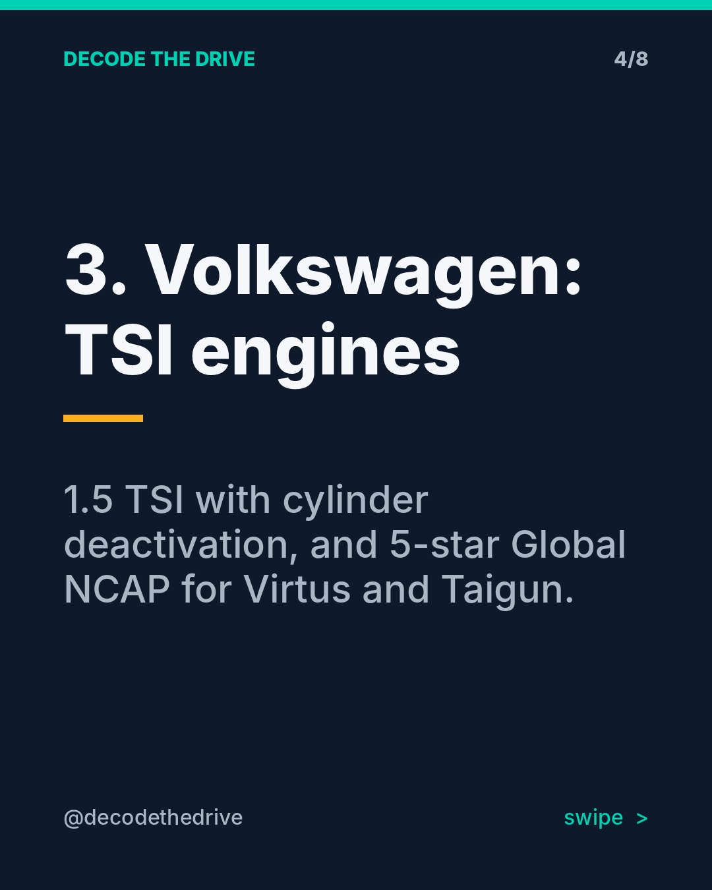
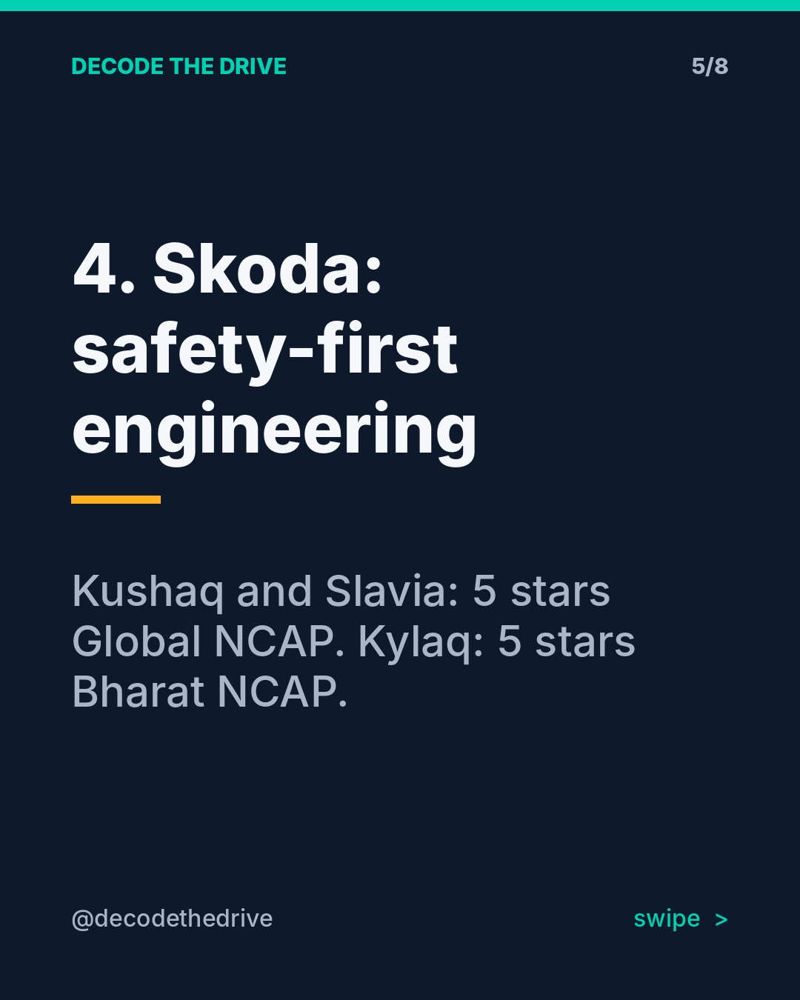
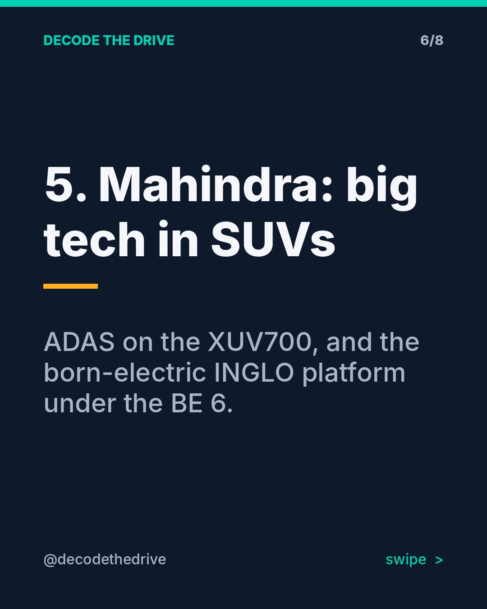
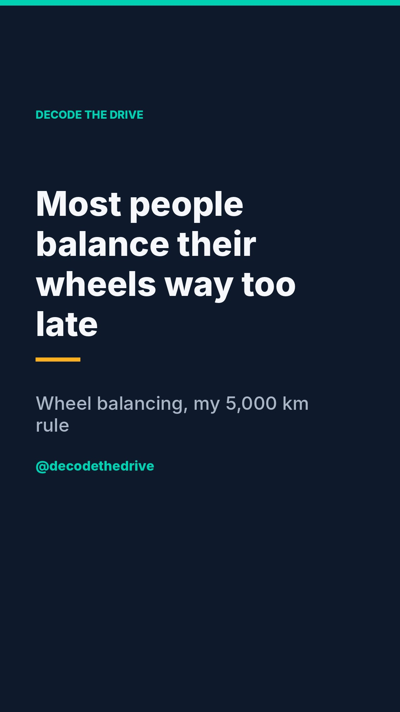

# Week of 2026-10-18: Myth-busting week: real-world car tech truths for Indian roads, plus the launch of the brand series with a vote

Check the posts below. If they look good, run **approve-all** from the Actions tab.

## 2026-11-02 20:00 · meme · Claimed mileage = sprint estimate
Post id: `718e1f27`

**Caption:**

Every IT person knows this feeling 😅 The brochure number is the planning estimate. Your real mileage depends on traffic, AC use, tyre pressure, load and your right foot.

Claimed figures are measured in standard lab test cycles, not in peak-hour traffic. They are useful for comparing cars with each other, but not as a promise.

What's the gap between your car's claimed and real mileage? Drop it below 👇 Tag the friend who still quotes the brochure number.

#CarMemes #ITLife #CarTech #Mileage #FuelEfficiency #IndianCars #TechHumour #SoftwareEngineer #CarLovers #DecodeTheDrive

## 2026-11-03 19:30 · reel · Does DC fast charging damage the battery
Post id: `1fc7a46e`

 (tap for the video)

Music: the_mountain-tech-corporate-593075.mp3 (tech)

YouTube Shorts title: **Does DC fast charging damage your EV battery?**
YouTube hashtags: #shorts #EVCharging #CarTech

**Caption:**

Does DC fast charging damage the battery? Short answer: occasional fast charging is fine. The car protects itself.

🔋 The Battery Management System (BMS) decides how much power the cells accept. It slows charging when the battery is hot or nearly full.
🐢 That's why the last 20% takes so long. It is deliberate.
🔥 What adds extra wear: fast charging to 100% every day, in peak heat, right after hard driving.

My simple rule: AC charging at home for daily use, DC on road trips, and stop around 80% when you can.

Do you fast charge often or mostly charge at home? Tell me in the comments.

#EVCharging #ElectricVehicles #EVIndia #FastCharging #EVBattery #BatteryHealth #CarTech #ElectricCars #EVTips #IndianCars #DecodeTheDrive

## 2026-11-04 19:30 · reel · Is ADAS useful on Indian roads
Post id: `26ec0456`

 (tap for the video)

Music: prettyjohn1-future-bass-523169.mp3 (upbeat)

YouTube Shorts title: **Is ADAS actually useful on Indian roads?**
YouTube hashtags: #shorts #ADAS #CarTech

**Caption:**

"ADAS doesn't work in India" is half true. Here's the honest version.

✅ Highways and expressways: adaptive cruise and lane keep assist really do reduce fatigue on long drives.
❌ City traffic: faded lane markings, bikes cutting in and tight gaps can confuse the cameras and radar, so you get beeps and nudges.
🛑 The quiet hero: automatic emergency braking. It's a backup for the moment you get distracted, not a replacement for you.

My setup: keep AEB on always, and switch lane keep off in the city if it fights you. Hands on the wheel, eyes on the road, always. No car on sale in India drives itself.

Does your car have ADAS? Do you keep it on or off? 👇

#ADAS #CarSafety #CarTech #IndianRoads #AdaptiveCruiseControl #DrivingTips #IndianCars #SafeDriving #CarFeatures #AutomotiveTech #DecodeTheDrive

## 2026-11-05 20:00 · carousel · Brand series kickoff + vote
Post id: `3cd9f131`

**Caption:**

New series alert 🚗 One deep-dive post per brand on what it does best and its signature tech. First, the one-line version of each.

Honda: the City e:HEV strong hybrid, plus Honda Sensing camera-based ADAS.
Hyundai: features for the money, with Level 2 ADAS and Bluelink connected tech on models like the Creta and Verna.
Volkswagen: 1.5 TSI with cylinder deactivation, and 5-star Global NCAP ratings for the Virtus and Taigun.
Skoda: the same safety-first engineering, with the Kushaq and Slavia at 5 stars in Global NCAP and the Kylaq at 5 stars in Bharat NCAP.
Mahindra: big tech in SUVs, from ADAS on the XUV700 to the born-electric INGLO platform under the BE 6.

YOU decide which brand gets the full deep dive first. Comment 1, 2, 3, 4 or 5 👇 Most votes wins.

#Honda #Hyundai #Volkswagen #Skoda #Mahindra #CarTech #IndianCars #CarComparison #NewCar #CarBuyingGuide #AutoIndia #DecodeTheDrive

## 2026-10-31 11:00 · reel · Owner tip: wheel balancing every 5,000 km
Post id: `9e8541e4`

 (tap for the video)

Music: atlasaudio-lofi-chill-589987.mp3 (chill)

YouTube Shorts title: **How often should you do wheel balancing? My 5,000 km rule**
YouTube hashtags: #shorts #WheelBalancing #CarMaintenance

**Caption:**

My non-negotiable maintenance habit: wheel balancing every 5,000 km, without fail. If the steering starts vibrating, I go sooner.

Why? Indian potholes and speed breakers can knock balancing weights loose. An unbalanced wheel wears tyres unevenly, adds stress on suspension and steering parts, and makes highway drives tiring.

Warning signs: steering shake around 80-100 km/h, patchy tyre wear, or a hum that grows with speed.

⚠️ Safety note: if the vibration starts right after a big pothole hit, get the tyre and rim checked for bulges or bends before any highway run. Balancing won't fix a damaged tyre.

Bonus: balancing and alignment are different. Balancing fixes vibration. Alignment fixes the car pulling to one side.

When did you last get yours done? Be honest 😄

#WheelBalancing #CarMaintenance #CarCare #TyreCare #DrivingTips #CarTips #IndianRoads #Potholes #IndianCars #CarOwners #DecodeTheDrive

## Story polls (post these yourself)

- **Mon**: Your real mileage vs the brochure figure?  (Pretty close / Not even near)
- **Tue**: How do you mostly charge (or would charge) an EV?  (Home AC / Public DC)
- **Wed**: Would you pay extra for ADAS?  (Yes, for safety / No, not for India)
- **Thu**: Which matters more in your next car?  (Safety rating / Feature list)
- **Fri**: Weekend drive plan?  (Highway trip / City errands)
- **Sat**: When did you last get wheel balancing done?  (Under 5,000 km ago / Can't remember)
- **Sun**: Next car: which fuel?  (EV / Petrol or hybrid)
